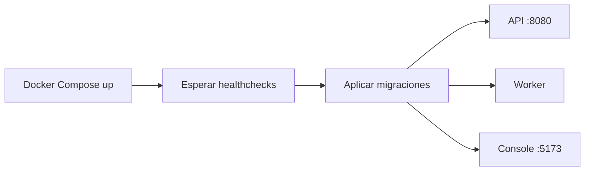

# Desarrollo local

## Requisitos

- Go según la versión declarada en `apps/api/go.mod`.
- Node.js y pnpm.
- Docker con Docker Compose.

## Preparación

Desde la raíz del repositorio:

```bash
pnpm bootstrap
```

## Ejecución completa

```bash
pnpm dev
```

El comando realiza esta secuencia:



Los procesos también pueden iniciarse por separado:

```bash
pnpm infra:up
pnpm migrate
pnpm api
pnpm worker
pnpm console
```

No deben ejecutarse dos instancias locales de `pnpm dev` sobre los mismos
puertos. Para comprobarlos:

```bash
ss -ltnp | grep -E ':8080|:5173|:5432|:4222'
```

## Verificación

```bash
pnpm check
pnpm build
pnpm test:integration
```

Las pruebas de integración crean la base aislada `imageflow_test` y streams
temporales de NATS. Los tests Go permanecen junto al paquete que prueban; los
de integración usan `//go:build integration`.

## Documentación de API

Con la API en ejecución:

```text
http://localhost:8080/docs
http://localhost:8080/openapi.yaml
```

`openapi/openapi.yaml` es el contrato fuente. Al modificar un endpoint se debe
actualizar el contrato y sus pruebas en el mismo cambio.

## Autenticación local

Las rutas `/v1/*` requieren una API key. Al ejecutar `pnpm dev`, los scripts
locales configuran exclusivamente para desarrollo esta clave compartida entre
la API y la consola:

```text
if_test_local_development_key_change_me
```

La migración no guarda esta credencial. La API solo la crea cuando recibe
`IMAGEFLOW_DEVELOPMENT_API_KEY`, variable definida por el comando local de
desarrollo. Los builds de producción de la consola tampoco contienen una clave.

Para crear otro proyecto y emitir su primera clave:

```bash
cd apps/api
go run ./cmd/admin --name "Mi aplicación" --environment test
go run ./cmd/admin --name "Mi aplicación productiva" --environment live
```

El comando imprime el secreto una sola vez. En clientes HTTP se envía como
`Authorization: Bearer <api-key>`. La consola puede usar otra clave con
`VITE_IMAGEFLOW_API_KEY`.

## Datos locales

PostgreSQL escribe en `infra/docker/data/postgres` y los resultados procesados
en `infra/docker/data/objects`; ambos quedan excluidos de Git. NATS usa el
volumen `imageflow_nats_data`.

El almacenamiento local es el predeterminado y no requiere otro contenedor.
Para conectar un proveedor S3-compatible como Cloudflare R2:

```text
IMAGEFLOW_STORAGE_DRIVER=s3
IMAGEFLOW_S3_ENDPOINT=https://<account-id>.r2.cloudflarestorage.com
IMAGEFLOW_S3_REGION=us-east-1
IMAGEFLOW_S3_BUCKET=imageflow
IMAGEFLOW_S3_ACCESS_KEY=<access-key>
IMAGEFLOW_S3_SECRET_KEY=<secret-key>
```

La ruta local puede cambiarse mediante `IMAGEFLOW_STORAGE_PATH`.

Para detener servicios conservando los datos:

```bash
pnpm infra:down
```
