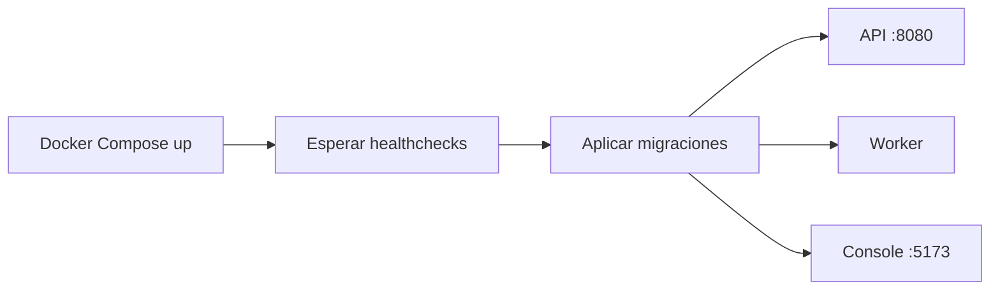

# Desarrollo local

## Requisitos

- Go según la versión declarada en `apps/api/go.mod`.
- Node.js y pnpm.
- Docker con Docker Compose.

## Preparación

Desde la raíz del repositorio:

```bash
pnpm bootstrap
```

## Ejecución completa

```bash
pnpm dev
```

El comando realiza esta secuencia:



Los procesos también pueden iniciarse por separado:

```bash
pnpm infra:up
pnpm migrate
pnpm api
pnpm worker
pnpm console
```

No deben ejecutarse dos instancias locales de `pnpm dev` sobre los mismos
puertos. Para comprobarlos:

```bash
ss -ltnp | grep -E ':8080|:5173|:5432|:4222'
```

## Verificación

```bash
pnpm check
pnpm build
pnpm test:integration
```

Las pruebas de integración crean la base aislada `imageflow_test` y streams
temporales de NATS. Los tests Go permanecen junto al paquete que prueban; los
de integración usan `//go:build integration`.

## Documentación de API

Con la API en ejecución:

```text
http://localhost:8080/docs
http://localhost:8080/openapi.yaml
```

`openapi/openapi.yaml` es el contrato fuente. Al modificar un endpoint se debe
actualizar el contrato y sus pruebas en el mismo cambio.

## Datos locales

PostgreSQL escribe en `infra/docker/data/postgres` y los resultados procesados
en `infra/docker/data/objects`; ambos quedan excluidos de Git. NATS usa el
volumen `imageflow_nats_data`. La ruta de resultados se puede cambiar mediante
`IMAGEFLOW_STORAGE_PATH`.

Para detener servicios conservando los datos:

```bash
pnpm infra:down
```
