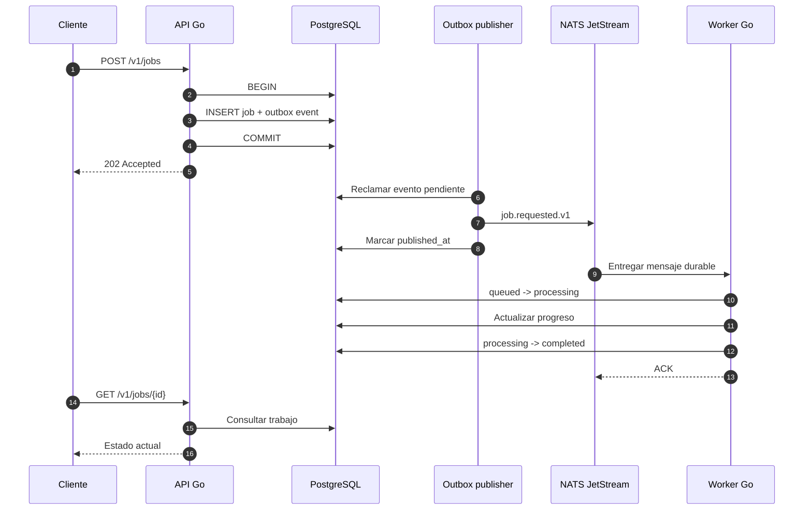

# Operación del backend

Este documento describe el comportamiento operativo actual del entorno local.
No constituye todavía una guía de producción.

## Flujo de creación y procesamiento



## Entrega y reintentos

- La entrega es al menos una vez.
- El outbox usa un ID estable como `Nats-Msg-Id`.
- El consumidor durable tiene entregas ilimitadas en NATS.
- La aplicación controla el máximo con
  `IMAGEFLOW_NATS_MAX_DELIVERIES`, cuyo valor predeterminado es 10.
- Un error programa una nueva entrega después de cinco segundos.
- Al agotar el límite, el trabajo se marca `failed`, el mensaje se publica en
  `IMAGEFLOW_JOBS_DLQ` y la entrega original termina.

## Recuperación de trabajos

Un trabajo `processing` cuya marca `updated_at` tenga más de 15 segundos puede
ser reclamado nuevamente. Este mecanismo es provisional. El procesamiento real
deberá mantener un heartbeat o lease explícito para evitar reclamos simultáneos
en operaciones largas.

## Healthchecks

```text
GET /health/live   confirma que el proceso HTTP está vivo
GET /health/ready  confirma conectividad con PostgreSQL
```

Docker Compose también verifica PostgreSQL y NATS antes de ejecutar las
migraciones.

## Diagnóstico local

```bash
pnpm infra:status
pnpm infra:logs
curl -s http://localhost:8080/health/ready
curl -s 'http://localhost:8222/jsz?streams=true&consumers=true'
```

Consultar eventos recientes del outbox:

```bash
docker compose -f infra/docker/compose.yaml exec -T postgres \
  psql -U imageflow -d imageflow -c \
  "SELECT id, aggregate_id, attempts, available_at, locked_at, published_at, last_error
   FROM outbox_events ORDER BY id DESC LIMIT 20;"
```

## Límites actuales

- Sin autenticación, cuotas ni rate limiting.
- Sin métricas ni trazas distribuidas.
- Sin reconciliador automático de DLQ.
- Sin backup configurado para el bind mount local.
- Sin configuración productiva de TLS o secretos.

